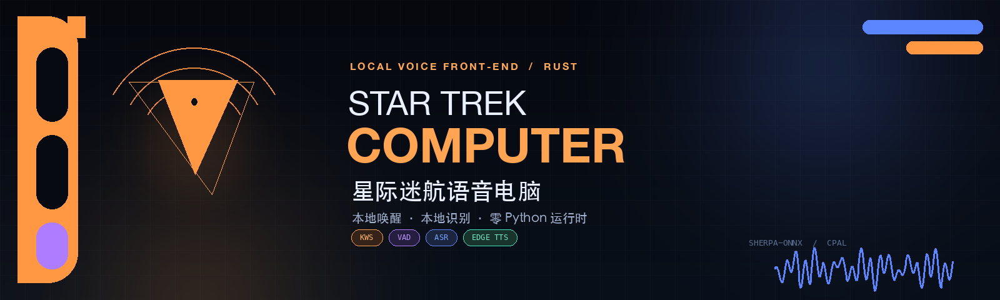

<p align="center">
  <b>为避免Star Trek IP风险，中性版（已移除星际迷航相关名称、图标与音效）已独立发布：<a href="https://github.com/zhj-ldm/AVA">zhj-ldm/AVA</a></b><br>
  本仓库保留星际迷航风格完整版；需要通用版本请前往 AVA 仓库。
</p>

---

<p align="center">
  
</p>

<p align="center">
  <a href="https://github.com/zhj-ldm/Star-Trek-voice-computer-rust/releases/latest"></a>
  
  
  
  
</p>

<p align="center">
  <b>喊一声 <code>computer</code>，它醒了。说完直接给指令，全程不用碰键盘。</b><br>
  唤醒与语音识别完全在本机运行；后端是 Rust 二进制，运行时零 Python 依赖。
</p>

> 一个带 Electron 界面的桌面语音助手：本地 KWS / VAD / ASR 语音前端 + 单 Agent 编排 + Skills + MCP 连接器 + 长期记忆 + 定时任务 + 多引擎联网搜索。

<details>
<summary><b>目录</b></summary>

- [30 秒读懂](#30-秒读懂)
- [核心能力](#核心能力)
- [快速开始](#快速开始)
- [模型准备](#模型准备)
- [语音链路](#语音链路)
- [系统结构](#系统结构)
- [模型接入](#模型接入)
- [配置](#配置)
- [API](#api)
- [打包 macOS App](#打包-macos-app)

</details>

## 30 秒读懂

```text
你说 "computer"
      ↓
本机 KWS 确认唤醒（不联网）
      ↓
你继续说指令，本机 ASR 转成文字（不联网）
      ↓
文字发给大模型 → 回复通过 TTS 念出来
```

**这是一个“本地语音入口 + 云端大脑”的架构，不是全离线模型。**

| 环节 | 运行位置 | 需要网络 | 说明 |
| --- | --- | --- | --- |
| 麦克风采集 | 本机 | 否 | cpal / CoreAudio |
| 唤醒 KWS | **本机** | 否 | sherpa-onnx Zipformer，约 5 MB |
| 录音结束判定 VAD | **本机** | 否 | Silero VAD，约 629 KB |
| 语音识别 ASR | **本机** | 否 | sherpa-onnx Paraformer-zh，约 234 MB |
| 大模型推理 | 云端 / 自有端点 | 是 | OpenAI Chat Completions 或 Anthropic Messages |
| 语音合成 TTS | 云端 | 是 | Edge TTS |
| 联网搜索 | 云端 | 是 | 多引擎聚合 |

> 准确的边界：音频采集、唤醒、VAD 和转写全部在本机；LLM 与 TTS 仍然需要网络。<br>
> “零 Python”指**运行时**不需要 Python、pip、conda 或 venv，模型准备阶段可以使用官方下载脚本。

## 核心能力

### 本地语音闭环

- **KWS 唤醒词**：sherpa-onnx Zipformer，流式 100 ms 分块检测，默认唤醒词 `computer`。
- **Silero VAD 收尾**：检测到人声后，连续静默 1.5 秒就结束并发送；整段没人说话时等待 4 秒自动结束回到监听。两者都可在设置中调整；模型缺失时自动降级到 RMS 能量判定。
- **本地 ASR**：Paraformer-zh，FunASR 同源，不需要云端语音接口。
- **即时打断**：播报中说 `computer stop` 可以立即中断；TTS 支持 60 ms 级打断。
- **防自唤醒**：播报期间不判唤醒，播报结束清空采集缓冲，命中后仍有 2.6 秒抑制窗口。
- **唤醒诊断**：`GET /kws_diag` 返回最近 300 条窗口样本、RMS、噪声底、门限、增益、推理耗时与命中结果。

### Agent 与长期能力

- 单 Agent 编排，内置 `ImportSkill`、`ConnectMcp`、`WebSearch`、可选 `AskUserQuestion`，以及 bash / 文件读写 / 编辑 / WebFetch / 定时任务等工具。
- **MCP 连接器**：支持添加任意 MCP Server（stdio / HTTP/SSE），可探测、重连并查看已连接工具；AI 也能自主连接，成功后实时出现在「连接器 → MCP」列表。
- **渐进式工具加载**：默认只给模型基础工具，其余通过 `ToolGuide` 按需启用；设置页提供逐项开关，单独决定哪些工具进入默认加载集合。
- Skills、长期记忆、cron 定时任务、多会话与 SSE 事件流。
- 多上游模型分摊：多 Base URL / 多模型 / 多 Key，按上游独立 RPM 轮询。
- 语音回复自动取最终回复的 `【Voice】` 段，清洗 Markdown 后交给 TTS。
- **个人日志**：持续录音、静音不落盘，后台自动转写为 Markdown；详见 [Skills/README.md](Skills/README.md)。

### 桌面体验

- Electron 界面：连接器（Skills / MCP）、对话、记忆、定时任务、设置、唤醒日志。
- 工具调用汇总可展开，逐条查看每次调用的参数与返回结果；思考行完成后自动折叠。
- 每一轮问答可单独删除；被打断的轮次保留工具记录与耗时，重开 App 仍显示「被打断」。
- 可打包为 macOS `.app`；`mac-edition` 分支提供菜单栏常驻体验。
- 运行时资源使用项目相对路径，不依赖硬编码的用户目录。

## 快速开始

> **模型权重不随仓库分发**（ASR 约 234 MB、KWS 约 5 MB、VAD 约 629 KB）。<br>
> clone 后先按「模型准备」放置 KWS 与 ASR，再启动，否则语音进程无法工作。

```bash
git clone https://github.com/zhj-ldm/Star-Trek-voice-computer-rust.git
cd Star-Trek-voice-computer-rust

# 1. 编译 Rust 后端（core + voice-serve + journal）
cargo build --release

# 2. 安装 UI 依赖
cd ui && npm install && cd ..

# 3. 放置语音模型（见下一节），然后启动
./run.sh
```

首次启动需要在「系统设置 → 隐私与安全性 → 麦克风」允许终端或 App 访问麦克风。

## 模型准备

推荐把模型放进项目内：

```text
resources/models/
├─ kws/                    # sherpa-onnx-kws-zipformer 系列
│  ├─ tokens.txt
│  └─ keywords_computer.txt / keywords_break.txt
├─ paraformer-zh/          # sherpa-onnx Paraformer-zh
│  ├─ model.int8.onnx
│  └─ tokens.txt
└─ silero-vad/
   └─ silero_vad.onnx
```

也可以使用环境变量指向外部目录：

```bash
export KWS_DIR=/path/to/kws-model-dir
export MODEL_DIR=/path/to/sherpa-onnx-paraformer-zh
export VAD_MODEL=/path/to/silero_vad.onnx
export BEEP_FILE=/path/to/wake_sound.wav
./run.sh
```

下载 Silero VAD：

```bash
mkdir -p resources/models/silero-vad
curl -L -o resources/models/silero-vad/silero_vad.onnx \
  https://github.com/k2-fsa/sherpa-onnx/releases/download/asr-models/silero_vad.onnx
```

`sherpa-onnx` 优先使用 `SHERPA_ONNX_LIB_DIR` 指向的预编译静态库；未设置时构建脚本会自动下载。更完整的模型目录、编译依赖和可移植性说明见仓库内对应配置与 `run.sh`。

## 语音链路

```text
cpal 采集
  → 多声道合并 / 7 kHz 抗混叠低通
  → 相位连续重采样到 16 kHz
  → 自适应噪声底 + RMS 静音门控
  → 电平归一化
  → KWS 唤醒
  → 录音 + Silero VAD（有人声后静默 1.5 s 结束；无人声 4 s 超时）
  → Paraformer-zh ASR
  → Agent
  → Edge TTS
```

抗混叠、重采样相位、非对称噪声底、VAD 与 RMS 的关系、2.4 s 唤醒窗口、防自唤醒和即时打断等实现细节，整理在：

**→ [语音前端设计深潜](docs/VOICE_PIPELINE.md)**

## 系统结构

```text
star-trek-assistant/
├─ crates/
│  ├─ core/        star-trek-core：Agent 编排 / HTTP API / SSE / 拉起 voice-serve
│  ├─ voice/       voice-serve：KWS / ASR / TTS / 采集 / VAD / 日志
│  └─ journal/     个人日志 CLI
├─ ui/             Electron 界面
├─ resources/      音效 / prompts / 模型
├─ data/           运行时配置与会话（不入库）
├─ run.sh          一键启动
└─ update-app.sh   编译并覆盖桌面 App
```

Agent 主循环在 `crates/core/src/agents.rs` 中自行实现：每轮重建上下文与工具集，流式接收文本 / 思考与工具调用，
逐个执行后写回，每 30 ms 检查一次打断。模型调用复用 `rpi` 的 provider 流式接口与基础工具实现，
会话、事件流、记忆、调度、MCP 连接器由项目自己管理。

## 模型接入

支持两种协议，按模型名自动判定：

| 协议 | 端点 | 鉴权 | 典型模型 |
| --- | --- | --- | --- |
| OpenAI Chat Completions | `POST {Base URL}/v1/chat/completions` | `Authorization: Bearer <key>` | GPT / DeepSeek / Qwen / GLM / Mistral / Llama / Gemini |
| Anthropic Messages | `POST {Base URL}/v1/messages` | `x-api-key` + `anthropic-version` | Claude 或其他 Anthropic 兼容端点 |

Base URL 可以写成 `https://api.openai.com`、`https://api.openai.com/v1` 或末尾带斜杠，程序会自动归一化。模型名不在启发式列表时，可设置：

```bash
export CODEANY_API_TYPE=openai-completions   # 或 anthropic-messages
```

> 本项目使用 OpenAI **Chat Completions**，不是 Responses API。

## 配置

运行数据在 `data/`，主配置为 `data/config.json`：

```json
{
  "providers": [
    {
      "name": "主 API",
      "base_url": "https://api.openai.com/v1",
      "model": "gpt-4o",
      "api_key": "YOUR_KEY",
      "rpm_limit": 20
    }
  ],
  "active_model": "主 API",
  "wakeword": "computer",
  "voice": "zh-CN-XiaoxiaoNeural",
  "rate": 1.05,
  "interrupt_keywords": ["stop", "停止", "停", "够了", "取消"],
  "max_record_secs": 120.0,
  "continuous_silence_secs": 1.5,
  "no_speech_timeout_secs": 4.0,
  "default_loaded_tools": [],
  "kws_threshold": 0.25,
  "voice_enabled": true
}
```

这些字段都可以在 UI 的设置页可视化编辑。`kws_threshold` 越低越灵敏，但更容易误触；调参前先查看 `/kws_diag` 的置信度分布。

## API

**core（默认 `127.0.0.1:8410`）**

| 方法 | 路径 | 说明 |
| --- | --- | --- |
| GET | `/health` · `/api/status` | 健康检查 / 状态 |
| GET | `/api/events` | SSE 事件流（对话 / 工具 / 语音 / 记忆 / Skills / MCP / 定时） |
| POST | `/api/chat` · `/api/chat/interrupt` | 发送文本 / 打断 |
| GET/POST | `/api/config` | 读写配置 |
| GET/POST | `/api/skills` · `/api/skills/:name` | Skills 管理 |
| GET/POST | `/api/memory` · `/api/memory/:id` | 记忆管理 |
| GET/POST | `/api/schedules` · `/api/schedules/:id` | 定时任务（cron 5 字段） |
| GET/POST | `/api/sessions` · `/api/sessions/:id` | 多会话管理 |
| DELETE | `/api/sessions/:id/messages/:mid` | 删除某一轮问答（用户消息及其后 AI 回复） |
| GET/POST | `/api/mcp/servers` · `/api/mcp/servers/:id` · `.../reconnect` | MCP 连接器管理与探测 |
| GET/POST | `/api/tools` | 渐进式加载的默认工具开关 |

**voice-serve（默认 `127.0.0.1:8420`）**

| 方法 | 路径 | 说明 |
| --- | --- | --- |
| GET | `/health` · `/status` · `/kws_diag` | 状态与唤醒诊断 |
| POST | `/speak` · `/interrupt` · `/beep` | TTS / 打断 / 提示音 |
| POST | `/listen_once` · `/transcribe` | 单次识别 / 音频转写 |
| POST | `/wakeword_once` · `/wakeword_detect` | 单次唤醒 / 唤醒检测 |
| POST/GET | `/journal/*` | 个人日志录制与转写 |

## 打包 macOS App

```bash
./update-app.sh
```

会编译 release 后端并覆盖桌面 `Star Trek Computer.app`（包含自签重签）。也可以用 `ui/package.json` 中的 `npm run dist` 生成 Electron 安装包。

macOS 麦克风 TCC 权限异常时，需要对 `.app` 做深度重签。菜单栏常驻版本在 `mac-edition` 分支。

## 设计边界

- 唤醒词模型约 5 MB，CPU 推理即可，不需要 GPU。
- ASR 模型约 234 MB，首次使用需要单独下载。
- LLM 与 TTS 仍是云端调用，不能宣称“完全离线”。
- 本项目不是 Python 语音方案的封装：模型通过 Rust `sherpa-onnx` crate 调用，底层为 ONNX Runtime 原生库。
- 语音入口运行时不依赖 Python；录音、转写不出本机。
- 所有工具直接挂在主 Agent 上，单层编排，不额外引入子 Agent 层。

## License

[Apache License 2.0](LICENSE)

模型调用与基础工具实现依赖 [`rpi`](https://github.com/bigfish1913/pi-rust)，遵循其自身开源协议。Star Trek 及相关名称为各自权利人商标；本项目为非官方个人项目。Star Trek 及相关名称为项目的界面风格，如有侵权请联系调整
